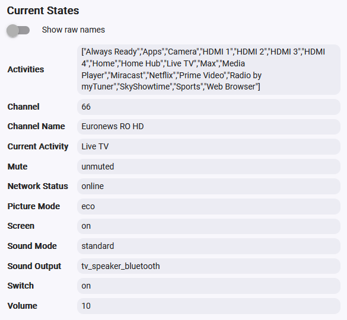
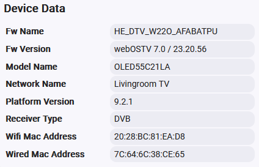

# LGTV with webOS

Hubitat driver to control LG TV devices using webOS websockets.

## Installation
There are two ways to install the drivers: using Hubitat Package Manager (HPM) or manually importing the driver code.

### HPM Installation (Recommended)
HPM is an app that allows you to easily install and update custom drivers and apps on your Hubitat hub. To use HPM, you need to have it installed on your hub first.

Once you have HPM installed, follow these steps to install the "LGTV with webOS" driver:

1. In the Hubitat interface, go to **Apps** and select **Hubitat Package Manager**.
1. Select **Install**, then **From a URL**.
1. Enter `https://raw.githubusercontent.com/9r5n76yjmzs-design/hubitat-lg-webos/main/packageManifest.json` and click **Next**.
1. Follow the install instructions.

This fork isn't in HPM's keyword search, which only lists packages in HPM's public directory. HPM can only install while this repository is public.

**Upgrading from Dan Danache's driver (namespace `dandanache`):** this fork uses its own namespace and package, so it installs alongside the original. After installing, open each TV device, change **Type** to the new **LGTV with webOS** driver, click **Save**, then remove the original package.

### Manual Installation
If you prefer not to use HPM, you can manually install the drivers by importing the driver code from GitHub:

1. In the Hubitat interface, go to **Drivers Code**.
1. Click **Add driver**, then select **Import** from the hamburger menu in the top right.
1. Enter `https://raw.githubusercontent.com/9r5n76yjmzs-design/hubitat-lg-webos/main/lgtv-with-webos.groovy` in the URL field.
1. Click **Import**, then click **OK** and the code should load in the editor.
1. Click **Save** in the top right.
1. Go to **Drivers Code**.
1. Click **Add driver**, then select **Import** from the hamburger menu in the top right.
1. Enter `https://raw.githubusercontent.com/9r5n76yjmzs-design/hubitat-lg-webos/main/component/lgtv-remote.groovy` in the URL field.
1. Click **Import**, then click **OK** and the code should load in the editor.
1. Click **Save** in the top right.

For more information on installing custom drivers, refer to the [Official Documentation](https://docs2.hubitat.com/en/how-to/install-custom-drivers).

## Create Devices

Follow these steps to create a new LG TV device:

### Configure IP address
1. Open your router's admin interface and set a static DHCP lease for your TV devices to ensure they always have the same IP addresses on your LAN.

1. Ensure the TV and the Hubitat hub are on the same subnet for Wake-On-LAN functionality to work.

### Configure TV
1. Ensure you are near your TV device, as this cannot be done remotely.
1. Power on the TV and open the TV settings.
1. Find and disable the **Always Ready** option (for OLED screens).
1. Enable the **Network IP Control** option.
1. Keep TV on for the following steps.

### Add device
1. In the Hubitat interface, go to **Devices**.
1. Click **Add device**, then select **Virtual**.
1. Select **LGTV with webOS** from the drivers list, then click **Next**.
1. Name your device (e.g., Livingroom TV), select a room, then click **Next**.
1. Click **View device details** to go to the device page.
1. Select the **Preferences** tab.
1. Enter the TV's IPv4 address (for example `192.168.1.50`), then click **Save**. Host names aren't accepted.
1. Approve the notification that appears on your TV screen.
1. A toast notification should appear briefly on your TV screen saying **Well done! Configuration is now complete**.
1. Select the **Commands** tab, then refresh the browser page to reload the attributes list.
1. If the **Current States** section does not populate with multiple attributes, check the Hubitat logs for clues. The log level starts at Info. To troubleshoot, set it to Debug: debug messages are shown for 30 minutes, then the log level switches back to Info automatically.

## Control options

The following commands are available:

### Power control
- On / Off

### Sound control
- Volume Up / Volume Down
- Set Volume (0% - 100%)
- Mute / Unmute
- Set Sound Output (tv_speaker, external_arc, external_optical, bt_soundbar, mobile_phone, lineout, headphone, tv_speaker_bluetooth)
- Play TTS announcements

### Live TV channel control
- Channel Up / Channel Down
- Set Channel

### Screen control
- Screen On / Screen Off
- Screen Saver On / Screen Saver Off
- Take screenshot
- Set Picture (brightness, contrast, color, backlight, and picture mode)

### App control
- Get All Activities - Populate the **Activities** attribute with available options for the **Start Activity** command
- Get Current Activity - Not actually needed as the current activity (running app) is automatically detected
- Start Activity - Start the specified app on the TV

### Media control
- Start, Pause, Stop the current file loaded in the Media Player app
- Start Video - Play the specified video file in Media Player app (`http://` or `https://` links only)
- Start Web Page - Open the specified URL in Web Browser app (`http://` or `https://` links only)

### TV Remote control
- Orchestrate and execute (simulate) TV Remote button pushes. Example buttons sequence: `MENU WAIT:2000 LEFT ENTER WAIT:1500 DOWN DOWN DOWN BACK`.

  See list of all possible buttons [in the source code](component/lgtv-remote.groovy).

  By default, a pause of 350 ms is added between button pushes. You can override this by using the special 'WAIT:xxx' instruction, where xxx = time, in milliseconds (0 to 10000), to wait before sending the next button push. Up to 100 buttons and waits can be queued at once.

### Notifications
- Device Notification - Display toast or an alert notifications to the TV screen

## Notes

#### Pairing key
When the TV accepts pairing, the driver saves the TV's pairing key in the masked **Pairing key** preference. Earlier versions kept it under State Variables; it is moved automatically, and the State Variables copy is deleted once the driver has read the key back from the preference. Hubitat may show the field blank even when it holds a key. To pair again (for example after a TV reset), clear **Pairing key**, click **Save**, and accept the prompt on the TV. The key lets anything on your network control the TV, so don't share it. Hubitat has no encrypted storage: the key is still kept unencrypted on the hub and in hub backups. See [SECURITY.md](SECURITY.md).

#### Wake On LAN
When the TV is first paired with the Hubitat, the driver will attempt to auto-enable the Wake-On-LAN (WOL) settings on your TV.

#### Detect TV start
When the TV is turned on using its remote, it does not broadcast any message to the LAN. To overcome this, the driver periodically probes the TV's websocket port (TCP 3001 with SSL, 3000 without) at the interval set with the **Set Ping Interval** command. ICMP ping is not used, so no ICMP firewall rule is needed. The default interval is 5 minutes, so it can take up to 5 minutes for the driver to detect that the TV was turned on.

Have fun!

---

## Known limitations (2.0.0)

- **Acceptance tests not complete:** LG-06 (power off/on and standby; Wake-on-LAN power-on did not work on the test TV), LG-07 (network drop and recovery) and LG-08 (internet down, home network up).
- **The TV's certificate isn't verified** until a private certificate store is available. See [SECURITY.md](SECURITY.md).
- **Tested on one webOS 23+ TV.** Other models and firmware versions may behave differently.

---

## Upstream Attribution and Project Provenance

This project is a maintained fork of **LGTV with webOS**, originally developed by **Dan Danache**.

- **Original repository:** https://codeberg.org/dan-danache/hubitat
- **Original source directory:** `lgtv-drivers/`
- **Original author:** Dan Danache
- **License:** The Unlicense (public domain)

The driver was extracted from the upstream repository using `git-filter-repo --subdirectory-filter lgtv-drivers`, preserving the relevant development history. Git commit identifiers were rewritten during extraction.

This fork is intended to support LG televisions running **webOS TV 23 and later**, with independently maintained compatibility updates and diagnostic improvements.

The original project and its contributors retain full credit for their work. This fork is independently maintained and is not affiliated with or endorsed by the original author.

See [LICENSE](LICENSE) for the original public-domain license terms.

